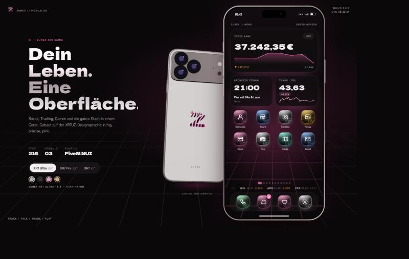
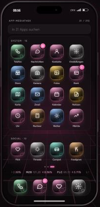
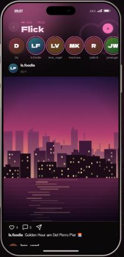
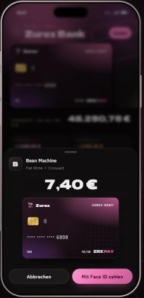
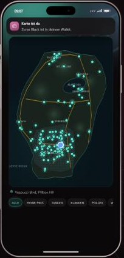

<div align="center">

# Zurex Phone · XR7

**Das Smartphone für FiveM-Roleplay. 216 Apps, drei Modelle, ein Design.**

QBCore · Qbox · ESX · Standalone



</div>

---

## Was drin ist

| Bereich | Apps |
| --- | --- |
| **System** | Telefon (Anrufe mit pma-voice / SaltyChat), Nachrichten mit Fotos und Standort, Kontakte, Kamera mit sechs Modi, Fotos, Zmail, Kalender, Notizen, Uhr, Rechner, Wetter, Karte, Zurex Store |
| **Bank & Zurex Pay** | Girokonto, sechs Kartentypen mit Cashback und Limit, kontaktlos bezahlen mit Face ID, Geld senden, Rechnungen |
| **Social** | Flick (Fotos), Reelz (Kurzvideos), Ghost (Snaps), Chirp, Vidz, Livez, Threadz, Linkd, Reddot, Spark (Dating) und mehr |
| **Trading** | Tradr (Aktien & ETFs), Coinz (Krypto), Chartview (Kerzencharts, SMA/EMA/Bollinger/RSI, Preisalarme), FX Pro, Märkte: ein gemeinsamer Markt für alle Spieler |
| **Stadt** | Notruf, Rettung, Feuerwehr, Pannenhilfe, Ryde (Taxi) mit echter Job-Weiterleitung, 19 GPS-Orte-Apps, 8 Shops mit Lieferung ins Inventar |
| **Netz** | Fünf Mobilfunkanbieter mit Abdeckung pro Region, WLAN-Hotspots mit Passwort, Wunschnummern inklusive VIP-Nummern |
| **Games** | 29 Spiele (Snake, 2048, Flappy Z, Blocks, Sudoku, Wortel, Vier gewinnt …) + 8 Casino-Spiele mit Spielgeld |
| **Tools & Info** | Taschenlampe, Kompass, Tacho, Schrittzähler, Tracker, Rechner, Musik-Radio (live generiert, lizenzfrei), Gesetzbuch, Regeln, Wiki, Quiz |

Jede App hat ein eigenes Icon und eine eigene Farbe. Keine zwei Apps teilen sich ein Symbol (`npm run check` prüft das).

<p align="center">
  
  
  
  
</p>

## Installation

1. Ordner nach `resources/[phone]/zurex-phone` kopieren (Ordnername muss `zurex-phone` sein).
2. In der `server.cfg`:
   ```cfg
   ensure zurex-phone
   ```
3. Optional: Items `phone`, `phone_pro`, `phone_ultra` in deinem Inventar anlegen (siehe [docs/INSTALL.md](docs/INSTALL.md)).
4. `config.lua` anpassen, Server neu starten. Fertig. Eine Datenbank ist nicht nötig, Daten liegen in `data/db.json`.

Öffnen mit **F1** oder `/phone`, rebindbar in den FiveM-Tastenbelegungen.

## Konfiguration

Alles steht in [`config.lua`](config.lua): Framework, Taste, Modelle und Items, vorinstallierte und deaktivierte Apps, Umbenennungen, Integrationen, Dienste und Jobs, Shops, Märkte, Kartentypen, Mobilfunk und WLAN, Wunschnummern, Casino, Limits und Speicher. Details: [docs/CONFIG.md](docs/CONFIG.md).

Texte für Regeln, Gesetzbuch, Wiki und Quiz stehen in [`html/data/docs.js`](html/data/docs.js).

## Andere Scripts anbinden

```lua
-- Zahlung über Zurex Pay anfordern (Shop, Tankstelle, Restaurant …)
exports['zurex-phone']:RequestPayment(source, 24.99, '24/7 Supermarkt', function(paid)
  if paid then GiveItems(source) end
end, 'Einkauf')

-- Eigene App ins Handy bringen (wird als iframe geladen)
exports['zurex-phone']:AddApp({ id = 'garage', name = 'Garage', icon = 'car', color = '#5eead4', url = 'nui://my-garage/html/phone.html' })

-- Jede Handy-Aktion übernehmen oder erweitern
exports['zurex-phone']:RegisterHandler('shop.buy', function(src, args) ... end)
exports['zurex-phone']:On('feed.post', function(src, args, result) ... end)
```

Alle Exports und Events: [docs/API.md](docs/API.md).

## Browser-Mockup

Das Handy läuft auch ohne FiveM im Browser, mit 3D-Rückansicht, Modellwahl und allen Apps:

```bash
npm install
npm run dev     # http://localhost:5190
npm run check   # JS + Lua Syntax, App-Registry, Icons
```

## Struktur

```
client/main.lua        NUI-Bridge, Kamera, Voice, GPS, Taschenlampe
server/bridge.lua      Framework, Banking, Inventar, Jobs
server/store.lua       JSON-Speicher
server/market.lua      Kurs-Simulation (für alle Spieler gleich)
server/main.lua        RPC-Router, App-Logik, Exports
html/js/core.js        OS: Boot, Lock, Home, Router, Benachrichtigungen
html/js/engines-*.js   App-Engines (Social, Finanzen, Stadt, Tools)
html/js/games*.js      Games + Casino
html/js/registry.js    Alle Apps
html/js/icons.js       Ein Glyph pro App
```

## Hinweise

- App- und Markennamen (Flick, Reelz, Ghost, Tradr, Magentel …) sind eigene Namen. Echte Marken und Logos werden bewusst nicht verwendet.
- Die Kamera nutzt ingame **screenshot-basic**, wenn in `Config.Camera.uploadUrl` ein Upload-Ziel steht. Ohne Upload erzeugt sie stilisierte Szenen.
- Casino-Spiele nutzen nur Spielgeld-Chips und berühren nie das Bankkonto.

## Lizenz

[MIT](LICENSE)
